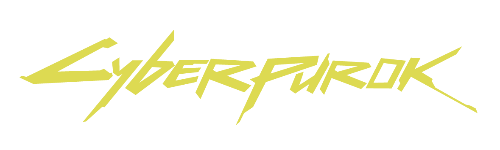

cyber_purok

This is repository for cyberpurok

Cyber_Purok is a project by Low_Bandwidth_Dreams

it started as an exhibition (0,0,0) and then to ESC Biennale.

### Tech Stack
- TypeScript
- [BabylonJS](https://babylonjs.com/) (game engine)
- [SvelteKit](https://kit.svelte.dev/) (meta-framework)

### Assets
All 3d and 2d assets are contributions from artists. 

-submit an optimized glb file

### AI Policy
The aim of this project is to teach the devs to code and for artists to sculpt and animate.
Since most of us are painting background, We use LLM to help us understand the syntax and other computer science concepts and to help generate boiler plate code. We refraim from full vibe coding.

We wont accept AI image-generated assets. 

If you use AI as part of your exploration(e.g trained from your own drawing), we might accept those assets.

